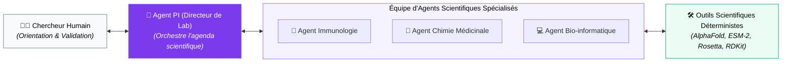
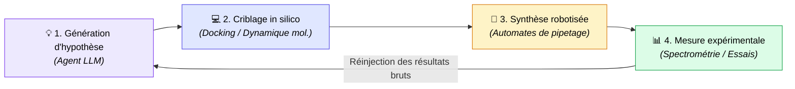

---
# try also 'default' to start simple
theme: seriph
# random image from a curated Unsplash collection by Anthony
# like them? see https://unsplash.com/collections/94734566/slidev
background: https://cover.sli.dev
# some information about your slides (markdown enabled)
title: Chercheur, un métier en pleine mutation
info: |
  ## Démo : review de papier assistée par IA
  Claude Code + Skills académiques + ILaaS — cloud souverain de l'ESR
# apply UnoCSS classes to the current slide
class: text-center
# https://sli.dev/features/drawing
drawings:
  persist: false
# slide transition: https://sli.dev/guide/animations.html#slide-transitions
colorSchema: light
highlighter: shiki
mdc: true
pdf: true
export: true
transition: slide-left
# enable Comark Syntax: https://comark.dev/syntax/markdown
comark: true
download: true
# duration of the presentation
duration: 35min
layout: cover
---

# Module 7 : Agents pour la Recherche
## De la synthèse bibliographique à l'AI Co-Scientist en laboratoire

  Sciences Computationnelles & Épistémologie
  
Automatisation de l'investigation, Virtual Labs (Stanford), reproductibilité et limites

---
layout: center
---

# Au programme

1. **Le constat** — un métier qui évolue vite
2. **La trajectoire** — de RAGaRenn à la fédération ILaaS
3. **Le principe** — votre interface chez vous, le cerveau dans un cloud souverain
4. **La démo** — la review d'un article de recherche *(live)*
5. **Ce que ça change** pour l'Université

<!-- Notes : Annoncer qu'on garde la partie technique brève et qu'on se concentre sur le sens. -->

---
layout: center
---

# Le constat : un métier qui évolue vite

  

    📚&nbsp;&nbsp;<b>Lire</b> 50 pages de littérature, veille, synthèses d'articles
  

  

    ✍️&nbsp;&nbsp;<b>Écrire</b> articles, expertises, réponses aux relecteurs
  

  

    ⚖️&nbsp;&nbsp;<b>Évaluer</b> produire du code pour expérimenter, comités de lecture, reviews, contre-expertises
  

La recherche change de vitesse. L'IA générative transforme chacun de ces gestes — tous les jours, un nouvel outil apparaît.

Notre réponse : <b>expérimenter</b> — de façon encadrée, sur des infrastructures que nous maîtrisons.

<!-- Notes : 3 mots : lire / écrire / évaluer. C'est exactement ce que la démo de tout à l'heure va illustrer (l'évaluation = la review d'un article). -->

---

# La trajectoire : de RAGaRenn à ILaaS

<b>2024</b> 🚀 <b>RAGaRenn</b> (Univ. Rennes) Assistant RAG open source, hébergé au datacenter régional de l'ESR breton (Eskemm Data)

<b>Début 2025</b> 🤝 <b>Fédération ILaaS</b> Mutualisation d'établissements partageant les mêmes constats

<b>Aujourd'hui</b> 🌍 <b>~80 établissements</b> Une infrastructure fédérée opérationnelle, ouverte à l'ensemble de l'ESR, 200+ applications
Extension du consortium de 5 à 24 partenaires

<b>Demain</b> 🛣️ <b>Feuille de route 2026</b> Perspectives de mutualisation nationale —  CINES (GENCI), AMUE, DINUM

Une IA alternative : <b>souveraine, sobre, résiliente, de confiance</b> — face aux solutions commerciales.

Une dynamique  : <b>portée par l'Université</b> — avec un soutien de collègues du laboratoire à leurs heures perdues.

<!-- Notes : RAGaRenn = le point de départ local. ILaaS = la mise à l'échelle collective. On souligne : même constat, démarche ascendante et fédérative, soutien du ministère. -->

---
layout: center
---

# ILaaS, le principe en une phrase

Votre interface reste chez vous, 
l'intelligence part dans un cloud souverain.

  
💻 <b>Le logiciel client</b> AnythingLLM, Claude Code… installés sur votre machine, avec vos habitudes

  
🔌 <b>L'API</b> un simple « lien », un standard ouvert (format OpenAI / Anthropic)

  
🧠 <b>Le modèle</b> hébergé sur l'infrastructure fédérée ILaaS

Comme la TV branchée sur un service de streaming : le contenu est produit ailleurs, on le consomme chez soi avec sa télécommande — sans verrouillage.

<!-- Notes : Analogie messagerie aussi possible (Thunderbird + serveur de mail). Le point clé : on découple l'outil du cerveau. C'est ce qui rend la mutation du métier absorbable. -->

---
layout: two-cols-header
---

# L'architecture

::left::

<diagramme>

  <b>VOTRE MACHINE</b> 
  · Claude Code (harnais + boucle agentique) 
  · Skills académiques (markdown) 
  · Fichiers, code, données <i>restent ici</i>

⬇ 🔑 API (Bearer)

  <b>ILaaS — cloud souverain de l'ESR</b> 
  · Passerelle LiteLLM 
  · Modèles : Qwen, Mistral, Gemma… 
  · <i>devllm.ilaas.fr</i>

</diagramme>

::right::

### Ce qui reste chez nous
- Documents, base vectorielle, embeddings
- Code, dépôt, hooks de sécurité
- Le raisonnement *visible*, étape par étape

### Ce qui part dans le cloud
- Uniquement le **contexte nécessaire**
- Extraits de documents, snippets de code
- Le calcul du modèle, puis le retour

 

✓ Confidentialité maîtrisée — on n'expose jamais tout, seulement le strict nécessaire.

<!-- Notes : L'important à faire passer : seuls des fragments utiles quittent la machine. On ne « donne pas ses données » à l'IA. -->

---

## Evolution des modèles ouverts

---
layout: cover
---

# L'Émergence de l'AI Co-Scientist

---
layout: default
---

# L'Émergence de l'AI Co-Scientist

L'IA en recherche ne se limite plus à la recherche de mots-clés : elle devient un partenaire d'expérimentation.

  
1. Exploration & Synthèse

  
Deep Research

  
Lire, croiser et synthétiser des centaines d'articles PDF, identifier les zones de controverse et les données manquantes.

  
2. Génération d'Hypothèses

  
Virtual Labs

  
Concevoir des protocoles, débattre entre agents spécialisés (chimie, immunologie) et proposer des cibles thérapeutiques.

  
3. Exécution & Calcul

  
In Silico ➔ In Vitro

  
Écrire des pipelines de docking, analyser des données omiques et piloter des automates de paillasse robotisés.

  💡 <b>Objectif visé :</b> Libérer les chercheurs des tâches mécaniques pour démultiplier le temps dédié à la créativité et à l'esprit critique.

---
layout: default
---

# 1. Recherche Bibliographique : Le "Deep Research"

Comment les agents dépassent les moteurs classiques (Google Scholar, PubMed) ?

### La fin de la recherche par mot-clé
- **Problème classique :** Trouver 50 articles sans savoir s'ils se contredisent ou s'ils ont été réfutés.
- **Workflow de Deep Research agentique :**
  1. Formulation d'un plan d'investigation multidimensionnel.
  2. Requêtes sémantiques ciblées sur des APIs scientifiques (Semantic Scholar, arXiv, Europe PMC).
  3. Téléchargement et lecture exhaustive des PDF complets (pas seulement l'Abstract).
  4. Suivi itératif des graphes de citations (*Forward & Backward snowballing*).
  5. Synthèse rédigée avec mise en tableau des preuves et extraction des tailles d'effet ($p$-values, effect sizes).

  
// Log d'un agent de recherche bibliographique :

  
1. RECHERCHE : "CRISPR off-target detection methods 2024..2026"

  
2. ANALYSE : 42 articles récupérés.

  
⚠️ DIVERGENCE DÉTECTÉE :

  
L'article A (Nature Biotech) affirme une sensibilité de 99% pour GUIDE-seq, mais l'article B (Cell) montre un biais sur les régions hétérochromatiques.

  
3. ACTION : Téléchargement des articles C et D pour trancher le consensus méthodologique.

---
layout: default
---

# 2. Agents pour l'Analyse de Données Scientifiques (EDA)

Remplacer les manipulations manuelles sous Excel par des analyses statistiques sandboxées et reproductibles.

### L'Agent Analyste en Bac à Sable :
- **Exploration automatisée (EDA) :** Détection des valeurs aberrantes, distribution des variables, tests de normalité.
- **Statistiques rigoureuses :** L'agent sélectionne le bon test (ANOVA, Mann-Whitney, régression logistique) et vérifie explicitement les hypothèses sous-jacentes.
- **Visualisation aux normes de publication :** Génération de graphiques vectoriels prêts pour l'impression (Matplotlib/Seaborn 300 DPI, palettes accessibles aux daltoniens).

  
Le risque du "P-Hacking" automatisé

  

    Un agent sans garde-fous statistiques peut tester 200 combinaisons de variables jusqu'à trouver un $p < 0.05$ purement fortuit.
  

  

    🛡️ <b>Contre-mesure :</b> Imposer dans le prompt de l'agent l'application systématique de corrections pour tests multiples (Bonferroni, Benjamini-Hochberg FDR).
  

---
layout: default
---

# 3. Découverte Assistée : Les "Virtual Labs" (Stanford)

L'équipe de **James Zou** (Stanford, *Nature 2025* / *Science 2026*) a formalisé le concept de **laboratoire virtuel multi-agents**.

svg]:max-w-4xl">

  

    <b>Réunions d'équipe simulées :</b> Les agents débattent, se contredisent et raffinent une hypothèse commune avant d'écrire la moindre ligne de code.
  

  

    <b>Cas réel (Nature 2025) :</b> Le Virtual Lab a conçu 92 nano-anticorps contre le SARS-CoV-2 ; validés expérimentalement en vrai labo (*wet lab*).
  

  

    <b>Échelle (Science 2026) :</b> Extension en "Virtual Biotech" avec 37 000 agents analysant 55 000 essais cliniques pour prédire la réussite de molécules.
  

---
layout: default
---

# 4. Sciences de la Vie & "Self-Driving Labs"

Quand l'agent quitte l'ordinateur pour piloter les instruments de paillasse en boucle fermée (*Closed-Loop Discovery*).

svg]:max-w-4xl">

### Rôle de l'agent dans la boucle :
- **Optimisation Bayésienne sémantique :** L'agent suggère la prochaine expérience à mener pour maximiser le gain d'information scientifique.
- **Adaptation en temps réel :** Si une réaction chimique échoue, l'agent modifie les concentrations ou la température pour l'itération suivante.

### Applications concrètes actuelles :
- **Science des matériaux :** Découverte accélérée d'électrolytes pour batteries solides.
- **Chimie médicinale :** Optimisation de petites molécules pour améliorer leur solubilité et biodisponibilité sans toxicité.

---
layout: default
---

# 5. Agents pour la Reproductibilité Scientifique

La "crise de la reproductibilité" trouve dans l'agentique un allié méthodologique majeur.

  
📦 1. Conteneurisation Native

  L'agent ne livre pas juste du code :
  - Il génère l'environnement exact (`Dockerfile`, environnement Conda verrouillé, `flake.nix`).
  - Épingle chaque version de bibliothèque logicielle.

  
🎲 2. Traçabilité des Aléas

  Élimination des facteurs confondants :
  - Fixation et journalisation systématique des graines aléatoires (`seeds`).
  - Capture de la version exacte des poids des modèles utilisés.

  
🔁 3. L'Agent "Auditeur Indépendant"

  Un second agent télécharge le dépôt git sur une machine vierge :
  - Il exécute tout le pipeline de calcul.
  - Vérifie que les figures et tables générées sont <b>strictement identiques au pixel près</b> à celles de l'article.

---
layout: two-cols-header
---

# 6. Écriture, Synthèse & Revue par les pairs (Peer Review)

L'assistance à la communication scientifique : atouts et dérives.

::left::
### Ce que l'agent fait remarquablement bien :
- **Structuration IMRaD :** Transformer des notes de paillasse éparpillées en plan d'article académique rigoureux.
- **Challenging d'arguments :** Jouer le rôle du « *Reviewer 2* » impitoyable :
  - *« Où est l'expérience de contrôle négatif pour la figure 3B ? »*
  - *« Vos conclusions dépassent la taille de votre cohorte. »*
- **Polissage linguistique :** Éliminer les maladresses pour les chercheurs non-anglophones natifs.

::right::

  
⚠️ DÉTECTION D'UN BIAIS PAR L'AGENT REVISEUR :

   
  "Dans la section Discussion, vous affirmez que le composé X inhibe la protéine Y.  
  <b>Problème d'inférence :</b> Les données de votre tableau 2 démontrent une corrélation, mais aucune expérience de knock-down n'atteste la causalité directe.  
  <b>Recommandation :</b> Nuancer le propos ou ajouter un test d'inhibition compétitive."

---
layout: default
---

# 7. Limites Épistémiques : Ce qu'un Agent NE PEUT PAS Valider

Un modèle de langage ne dispose d'aucune prise directe avec les lois physiques de l'Univers.

  
1. Vraisemblance Textuelle $\neq$ Vérité Empirique

  <ul class="space-y-1">
    <li>• Un LLM optimise la cohérence statistique des mots.</li>
    <li>• Il peut générer une hypothèse biologique <b>magnifiquement rédigée, élégante, logique... mais biologiquement totalement fausse</b>.</li>
    <li>• Seule la paillasse ou la mesure expérimentale tranche.</li>
  </ul>

  
2. Biais de Confirmation et "Echo Chambers"

  <ul class="space-y-1">
    <li>• Si le chercheur oriente son prompt (*« Démontre pourquoi le gène A cause B »*), l'agent va chercher des indices confirmatoires en ignorant les contre-preuves.</li>
    <li>• Hallucination subtile de citations existantes (attribuer une conclusion réelle au mauvais auteur).</li>
  </ul>

  
3. L'Indispensable Responsabilité de l'Expert Humain

  L'agent n'a pas de statut juridique ni de conscience déontologique. La signature d'un article scientifique engage la responsabilité morale et pénale du chercheur humain face à la fraude ou à l'erreur méthodologique.

---
layout: default
---

# Synthèse : La Charte du "Chercheur Augmenté"

Pour intégrer les agents dans une démarche de recherche intègre et féconde :

  <ul class="text-xs space-y-2 text-gray-700 dark:text-gray-200">
    <li>🔬 <b>Le modèle propose, la paillasse dispose :</b> Ne jamais considérer une hypothèse ou une synthèse d'agent comme un résultat scientifique sans validation expérimentale.</li>
    <li>🔍 <b>Traçabilité intégrale :</b> Déclarer explicitement l'usage des agents dans la section méthodologique (prompts utilisés, version des modèles, code d'orchestration).</li>
    <li>🛡️ <b>Audits statistiques stricts :</b> Interdire aux agents de calculer des statistiques inférentielles sans fournir le script Python inspectable et le contrôle du multi-test.</li>
    <li>🤝 <b>Adopter l'approche Virtual Lab :</b> Structurer les agents en équipes contradictoires spécialisées outillées d'instruments formels (AlphaFold, RDKit) plutôt qu'en simple prompt unique.</li>
  </ul>

---
layout: section
---

# 🎬 La démo

## La review d'un article de recherche, en direct

<!-- Notes : Transition vers le live. On fait de la place : la partie la plus parlante est celle qui vient. -->

---

# Le dispositif de la démo

  <b>1. Le harnais</b> 
  <b>Claude Code</b> — l'agent local qui observe, raisonne, agit, vérifie (boucle) et s'arrête à chaque étape pour notre confirmation.

  <b>2. La compétence</b> 
  <b>« Academic Paper Reviewer »</b> — un skill qui transforme l'agent en comité de lecture : 7 relecteurs spécialisés.

  <b>3. Le cerveau</b> 
  <b>ILaaS</b> — le modèle tourne dans un cloud souverain de l'ESR. On change de modèle sans changer d'outil, ni de réflexes.

⚠️ Rappel essentiel : <b>humain dans la boucle</b>. La question de recherche, l'argument et l'interprétation restent les nôtres — l'IA aide sur la besogne.

<!-- Notes : Trois briques indépendantes qui se composent : harnais, compétence, cerveau. C'est le fil rouge de toute la présentation. -->

---

# Ce que fait le skill « Paper Reviewer »

  

  👨‍🏫 <b>7 agents de relecture</b>, comme un vrai comité de rédaction :
  <ul>
  <li>3 relecteurs thématiques</li>
  <li>1 relecteur méthodologique</li>
  <li>1 vérificateur de citations — interroge Semantic Scholar pour traquer les références inventées</li>
  </ul>
  

  

  🥊 <b>Un « Devil's Advocate »</b> qui attaque la thèse :
  <ul>
  <li>protocole <b>anti-sycophantie</b> — il ne peut pas se rétracter trop vite sous la pression</li>
  <li>seuil de concession noté, pour éviter le biais de complaisance</li>
  </ul>
  

⚙️ <b>Frame-lock</b> : une IA qui critique une thèse reste souvent dans le cadre qu'on lui a donné — d'où un regard externe structuré.  Le pipeline <b>s'arrête à chaque étape</b> pour notre validation.

<!-- Notes : C'est le cœur « scientifique » de la démo. On insiste sur les garde-fous : anti-sycophantie, vérification des citations, human-in-the-loop. -->

---

# Déroulé de la démo *(live)*

1. On lance **Claude Code** pointé vers ILaaS (une clé API, pas de GPU chez nous)
2. On charge le skill « Academic Paper Reviewer »
3. On lui soumet l'article — le fichier reste **local**
4. **Observer** : l'agent lit l'article, découpe, cherche les faiblesses
5. **Raisonner → agir → vérifier** : il produit une review structurée, critères par critères
6. On **valide chaque étape** avant qu'il ne poursuive

⏱️ En autonomie sur la besogne ; le jugement scientifique reste nôtre.

<!-- Notes : Ici on fait la démo réelle. Le reste du discours tient en une phrase : regardez la besogne qu'on nous enlève, pas la décision. -->

---

# Meta-démo : la boucle est bouclée

Cette présentation elle-même a été <b>rédigée, relue et structurée</b> avec le même dispositif :

  
🛠️ <b>L'outil</b> Slidev — des slides écrites en Markdown, versionnées, relues comme du code

  
🤖 <b>L'agent</b> Claude Code, qui a drafté et auto-reviewé ce support

  
🧠 <b>Le cerveau</b> des modèles du catalogue ILaaS, en infrastructure souveraine

Demain, « faire sa présentation » ou « relire un papier » se fera ainsi : <b>l'outil change, l'habitude reste, le cerveau est mutualisé.</b>

<!-- Notes : Effet démonstratif fort. On montre que le dispositif n'est pas un gadget de technicien : il produit ici, sous vos yeux, le support que vous regardez. -->
---
layout: cover
---

# iLaaS, un catalogue de modèles LLM souverains pour l'ESR 

## => une infrastructure de recherche indispensable pour l'ESR

---
layout: center
---

# Ce que ça change pour l'Université

  

  🛡️ <b>Souveraineté & confiance</b> composants open source, données gérées dans l'ESR, cadre d'usage co-construit
  

  

  🌱 <b>Sobriété</b> zéro GPU individuel ; mutualisation et frugalité (choix de modèles efficients)
  

  

  🔓 <b>Pas de verrouillage</b> l'interface et le modèle évoluent indépendamment ; on change de modèle sans changer d'habitudes
  

  

  💶 <b>Coûts lisibles</b> quotas et consommation maîtrisés, pas d'abonnement tout-compris chez un seul fournisseur
  

Le meilleur des deux mondes : des outils familiers et soignés, adossés à des modèles puissants, <b>sans dépendance commerciale</b>.

---

## Où en est on ?

---
layout: center
---

# Et maintenant ?

1. 🔬 **Poursuivre la recherche** — création de 2 nouvelles équipes de recherche avec le **centre INRIA** (IA générative, reproductibilité & découvertes scientifiques) ; **un PEPR en cours d'écriture**
2. 📈 **Étendre** l'expérimentation — doctorants, équipes, comités de lecture
3. 📋 **Formaliser** les usages — charte, cadre d'usage
4. 🤝 **Mutualiser** à l'échelle nationale — CINES (GENCI), AMUE, DINUM
5. 🎓 **Former** personnels et étudiants

<!-- Notes : Ouverture. Si la rectrice le souhaite, proposer un atelier de prise en main pour ses équipes. -->

---
layout: end
class: text-center
---

# Fin du Module 7
### Échanges, débats épistémologiques & questions !

[The Virtual Lab (Nature 2025)](https://doi.org/10.1038/s41586-025-09442-9) · [Virtual Biotech (Science 2026)](https://doi.org/10.1126/science.aeg6779)